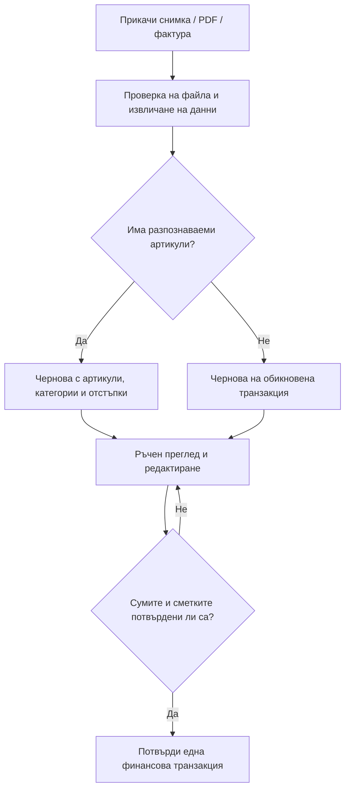

# Обработка на снимки, касови бележки и фактури — A4 (работна спецификация v0.1)

**Статус:** **ПРИЕТА е целта** да се извличат артикули/отстъпки/категории, когато присъстват, в **редактируема и изрично потвърждавана чернова**. Техническите средства, отделните състояния и сложните случаи **са предложения за обсъждане**, а не одобрен код. [Двуезично Issue #6](https://github.com/HristoManov91/family-finance/issues/6), [A2 #5](https://github.com/HristoManov91/family-finance/issues/5).

## 1. Какво иска потребителят — ПРИЕТО
- Прикача **снимка или документ** — PDF, касова бележка, фактура или друг подходящ формат (точните формати за MVP още се определят).
- Автоматично се проверява **дали документът съдържа редове с артикули**.
- При наличие се извличат **имена, крайни суми, евентуално количества/грамажи, единични цени и отстъпки**, ако документът ги предоставя.
- Предлагат се **подходяща главна категория и/или подкатегория**, като се ползват **незадължителните готови категории и създадените от потребителя**. Смисълът на категориите на заглавката спрямо тези на редовете остава за решение.
- Резултатът е **редактируема чернова** на транзакция: полетата на заглавката и **всеки отделен ред** могат да се поправят, добавят, премахват и прекатегоризират. **Няма автоматично осчетоводяване без потвърждение**.
- Документ **без разпознаваеми артикули** дава предложение за **обикновена транзакция без измислени редове**.
- Документно изречени/ръчно добавени отстъпки се отчитат в „**спестено**“ по транзакция и период.
- **Една транзакция** може да бъде свързана с **1+ финансови сметки**. Избрана от AI сметка **не се приема за потвърдена** без човешка проверка.

## 2. Предложен потребителски поток — изисква потвърждение

1. Качване на един или няколко изображения/PDF (въпрос: трябва ли един документ да има няколко кадъра/страници).
2. Проверки за реален формат, размер/страници, вирусен файл и позволен потребител/пространство. **Реалните документи се съхраняват частно**, никога в публично GitHub хранилище.
3. Извличане на видимите дата, магазин/доставчик, номер на документ, сума, валута, данни за артикули, количества, отстъпки и евентуално ДДС.
4. **Проверка на наличието на артикули**, без да извеждаме изкуствен артикул, ако документът е само платежен.
5. **Предложения за класификация**, основани на имена от документа, категории от общото пространство и евентуално предишни поправки (запомнянето е за решение).
6. Визуален преглед: оригинален файл до структурирана **чернова**, редакция на всяко поле, несигурни полета маркирани, видими отстъпки и „спестено“ само при надеждни данни.
7. Уточняване на сметката или няколкото сметки, датата и платената стойност; **сборът на плащанията трябва да съответства на общата сума** след валутните правила.
8. Еднократно **изрично потвърждение**. Документът/извличането не създава втори финансов разход; дублиране при повторно качване трябва да бъде предотвратено или ясно предупредено.
9. Възможност за последващи редакции с одит и възстановяване, съобразно правилата за общото пространство.

## 3. Предложени състояния
`UPLOADED` → `PROCESSING` → `DRAFT_READY` / `NEEDS_REVIEW` / `FAILED` → `USER_CONFIRMED` / `DISCARDED`. При неуспешно разпознаване потребителят трябва да може да добави/редактира ръчно и да използва документа само като прикачен файл.

## 4. Какво **не** трябва да се измисля
- **Име на продукт/количество/дата/търговец/отстъпка**, които не следват от документа или от изрично въведена информация.
- „Редовна цена“ само защото продуктът изглежда в промоция; „спестено“ се определя от действителна показана или ръчно въведена отстъпка.
- Фалшива точност на OCR при размазана касова бележка или фактура без артикули.
- **Финансовата сметка** само по текст от касова бележка; конкретното движение се определя/потвърждава от потребителя.
- Платежна транзакция за **неплатена фактура**, ако бизнес правилото за „платено/неплатено“ още не е договорено.

## 5. Гранични сценарии за обсъждане
- **Снимка с липсваща долна част** или две снимки на един дълъг бон; PDF с няколко страници и множество документи.
- **Само обща сума, без артикули** (касов бон за услуга, фактура само с обща сума).
- **Смесени категории** (храни + препарат), подкатегории според потребителя и промяна на главната категория.
- Отрицателни редове за отстъпка, купон върху целия бон, две отстъпки на един артикул, депозит/такса, ДДС.
- **Неравенство** между сума на редовете и общо платена; гранични закръгляния или пропуснат ред.
- **Снимка и PDF на същата покупка** или повторно качване; вече въведена транзакция, към която се прикачва документ по-късно.
- **Неплатена фактура**, авансово плащане и частично плащане.
- Разминаване между валута на покупката и валута на финансовата сметка, конкретна банкова сума и валутни такси.
- Потребителска редакция на името на продукт и същият продукт при следващо разчитане (дали запомняме съответствието).
- **AI недостъпен или външен доставчик отказва:** запазване на ръчния поток и черновата, без загуба на данни.

## 6. Въпроси за следващото интервю (DOC-01…DOC-09)
1. **Начин на качване:** директно в приложението или допълнително изпращане от ChatGPT към приложението?
2. **Начало на процеса:** качването автоматично попълва чернова или първо се отваря ръчна транзакция и към нея се прикачва файл?
3. **Категориите:** подкатегории на обща главна категория или различна главна категория за всеки артикул? Предложенията винаги ли са редактирани?
4. **Неясни полета:** задължително преглеждане на всички артикули или само на несигурните, преди потвърждение?
5. **Грешен сбор:** забрана за потвърждение или възможност за ръчно обяснена разлика?
6. **Дубликати/няколко страници:** едно качване с няколко снимки, проверка за повторения, прикачване към съществуваща транзакция?
7. **Фактура:** как се третира неплатена фактура — разход, задължение или чернова?
8. **AI поверителност и цена:** външен доставчик срещу локално разпознаване; срок за съхранение на оригинала; разход за извличане.
9. **Запомняне на корекции:** да учим ли лични/семейни псевдоними и категоризации от предишни потвърдени документи?

## 7. Условия за преминаване към реализация
Избрана подредба на екрани, одобрени данни/категории/състояния, финансово равенство, поведение при грешки и дубликати, права, сигурност, ретенции и реалистични **изцяло синтетични** тестови PDF/снимки. След това — **малки реализационни Issues, двуезични, с тестове**, а не недоговорен общ AI prompt.
